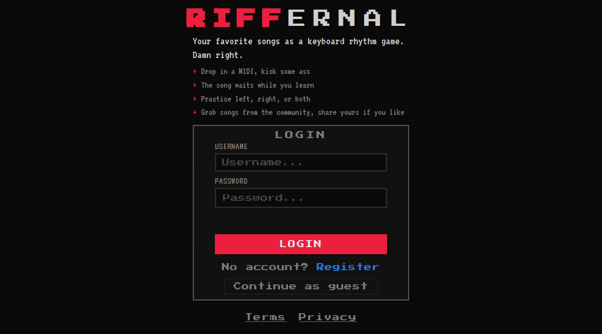

  <picture>
    <source media="(prefers-color-scheme: dark)" srcset="public/images/logo-dark.svg">
    
  </picture>

**A rhythm game for your MIDI keyboard — learn, play, share.**

Piano notes rain down the screen and your job is to catch them — with your
MIDI piano keyboard. Load any MIDI file (jazz ballads, metal riffs, prog
epics, that one 20-minute suite with eight movements nobody asked for).
It's a little community too: share the MIDI songs you import and browse
what other players are sharing.

LEARN mode meets you where you are: the song freezes mid-air while you sort
out your fingers, and practice loops let you grind that one evil bar forever.

PLAY mode turns it all into a proper rhythm game, with grades, combos and a
leaderboard — all served up in a charming pixel-art UI. Warm, low-stakes, and
completely judgment-free — even when you miss thirty notes in a row.

  

## Main features

- **LEARN mode** — the song freezes mid-air and waits for you to sort out
  your fingers.
  - **Freeze anywhere**: the clock pins at the next un-played note and
    resumes the instant you engage it; chords must be completed within
    200 ms. Other piano apps rewind or restart sections — this one never
    does.
  - **Timing feedback**: every hit shows how many ms early or late you
    were, so you can aim for on time.
  - **Hand isolation**: practice left or right hand alone while the other
    hand plays itself, with the accompaniment kept in sync.

- **Practice loops** — grind that one evil bar as long as it takes.
  - **Define**: set start and end notes right on the sheet music, for a song part which you want to practice.
  - **Note-granular editing**: trim or extend a loop one note at a time,
    with an audible preview of the chord.
  - **Chainable**: enable several loops and they play back to back, on
    repeat.
  - **Saved on the server**: your loops live per song, per user.
  - **Loops travel**: bookmark a song someone shared and the creator's
    practice loops are copied into your account — you inherit a practiced
    musician's learning plan which you can adapt.

- **PLAY mode** — a proper rhythm game.
  - **Timing grades**: Perfect / Great / Good, with
    combos, weighted accuracy and letter grades.
  - **Miss-friendly**: notes you miss keep playing themselves, so the
    song never stalls.
  - **Results screen**: grade, best combo, and your average hit timing offset
    (early/late/mixed).
  - **Daily leaderboard**: every scored run adds to your total for the
    UTC day; the top 10 sit on the home screen.

- **Online MIDI community** — import, play, share.
  - **Import any MIDI file**: pick the playable piano tracks, assign hands and
    background tracks at import.
  - **Share**: publish with one click; the community list is sorted by
    bookmark popularity, and bookmarked songs join your own library.
  - **Auto difficulty**: rated server-side from the notes you'll actually
    play — whole-song density blended with the densest 1-second burst.
  - **Guest mode**: import up to 20 songs locally and play everything
    with no account needed.

- **Gamification** — the music itself is designed as a game.
  - **Songs are levels**: every MIDI — imported or shared — becomes a
    game level with an auto-rated easy/medium/hard difficulty.
  - **Records**: a "New Best!" moment when you beat yourself, and each
    song keeps your best and last score.
  - **Campaigns**: a set of progressing songs to follow kind of like
    levels — coming soon.
  - **Visual rewards**: perfect-hit particles, and a combo boost that
    turns a hot streak into screen flames.
  - **Arcade dressing**: charming pixel-art UI, 8-bit menu sounds that
    re-tune slightly every day, CRT/grain display themes.

## Self hosting

Riffernal is a single Bun process with a single SQLite file — no external
services, no environment to babysit. See [INSTALL.md](docs/INSTALL.md) for
the requirements, setup and database details.

## License

Riffernal is open source under the [MIT license](LICENSE).

The bundled fonts ("Press Start 2P", "VT323") are under the
[SIL Open Font License 1.1](https://openfontlicense.org) — see
[frontend/assets/fonts/README.md](frontend/assets/fonts/README.md).
